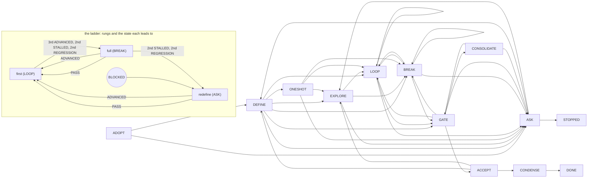

# Bridgecode 4.6.0

Bridgecode is a harness director for terminal coding agents. It routes each task, holds a frozen finish line, and directs the root agent and its delegates through an engine that enforces the method. The root reads one policy (the generalist); the engine (`node .bridgecode/engine/engine.mjs`) holds the task's state, hands out the card for each step, runs the commands that count as evidence, and refuses any transition whose conditions are not met, naming the command that meets them. A rubric of single-property criteria is the finish line. When a problem resists repair, the ladder moves the task to a bigger step back instead of another round of the same.

Every role is the root model by default. Optional cheapGPT and cLoop extensions change who runs a role, never how the work flows. `@bridgecode/cli` installs it into a project with Node 22+, git and no runtime dependencies; it never adds dependencies or lockfiles to your project. The short human guide is installed as `README_HUMAN.txt`.

## For agents: install

Read this README completely and inspect the target project before acting. Install, update or uninstall only when the user asks. Preserve repository-owned content; stop on ownership or integrity conflicts. Use the same clone (the same version) for the dry-run, the operation and doctor.

**1. Install from GitHub.** Bridgecode 4.6 is installed from a clone of this repository. npm holds `@bridgecode/cli` up to 4.3.2 as a record; 4.6 and later are not published there.

```sh
git clone --branch v4.6.0 --depth 1 https://github.com/LycurgusxLycurgus/bridgecode-cli.git <clone>
cd <the target project>
node <clone>/bin/bridgecode.mjs install --project . --edition codex --dry-run
node <clone>/bin/bridgecode.mjs install --project . --edition codex
node <clone>/bin/bridgecode.mjs doctor --project .
```

Add `--extension cloop:town` and/or `--extension cheapgpt:cheap` (one profile per extension) to both install commands when the user chose extensions. Keep the clone: its absolute path is in the installed hook commands, and `update` runs from it.

**2. Which edition.** Determine the harness you are running in:

| Harness | Edition | Instruction file |
| --- | --- | --- |
| Codex | `codex` | `AGENTS.md` |
| Claude Code | `claude` | `CLAUDE.md` |
| Claude Code, and the user has a Codex login and wants Codex models as delegates | `exp` (experimental) | `CLAUDE.md` |

Ask the user when the harness cannot be determined. No other harness is supported in this release.

**3. Which extensions to recommend.** Without an extension, every role (planner, builder, reviewer, loop-breaker, explorer) is a fresh instance of the root model. The cheapGPT extension gives building to cheaper models (profiles `cheap`, `cheap-100`); the cLoop extension gives planning, judging, loop-breaking and exploring to a two-model council (profiles `town`, `high`). Recommend at most one profile per extension. Both may be installed together: cLoop runs the council and cheapGPT builds. Recommend the pair when the user wants cross-model judging and cheaper building. The CLI resolves overlapping claims itself and writes the result to `.bridgecode/engine/roles.json`, which the engine reads. The tables below are the shipped roles data (`roles/*.json`).

codex edition (root in Codex; native children):

| Extension · profile | Root (recommended) | Planner / loop-breaker | Reviewer | Builder dynamic | Builder mechanical | Explorer |
| --- | --- | --- | --- | --- | --- | --- |
| cheapgpt · cheap | gpt-6.1-sol medium | gpt-6.1-sol xhigh | gpt-6.1-sol medium | gpt-6.1-terra medium | gpt-6-luna max | (core) |
| cheapgpt · cheap-100 | gpt-6.1-sol xhigh | gpt-6-astra xhigh | gpt-6.1-sol xhigh | gpt-6.1-terra max | gpt-6-luna max | (core) |
| cloop · town | gpt-6.1-sol medium | 2: gpt-6.1-terra max + gpt-6.1-sol medium | the same 2 | (core) | (core) | gpt-6.1-terra medium |
| cloop · high | gpt-6.1-sol high | 2: gpt-6.1-sol max + gpt-6-astra xhigh | the same 2 | (core) | (core) | gpt-6.1-sol medium |

claude edition (root in Claude Code; native Agent tool):

| Extension · profile | Root (recommended) | Planner / loop-breaker | Reviewer | Builder dynamic | Builder mechanical | Explorer |
| --- | --- | --- | --- | --- | --- | --- |
| cheapgpt · cheap | Opus 5.5 medium | Opus 5.5 xhigh | Opus 5.5 medium | Sonnet 5.5 medium | Haiku 5.5 xhigh | (core) |
| cheapgpt · cheap-100 | Opus 5.5 high | Fable 5.1 xhigh | Opus 5.5 high | Sonnet 5.5 xhigh | Haiku 5.5 xhigh | (core) |
| cloop · town | Opus 5.5 medium | 2: Sonnet 5.5 xhigh + Opus 5.5 medium | the same 2 | (core) | (core) | Sonnet 5.5 medium |
| cloop · high | Opus 5.5 high | 2: Opus 5.5 xhigh + Fable 5.1 xhigh | the same 2 | (core) | (core) | Opus 5.5 medium |

exp edition (root in Claude Code; Codex models through `codex exec`). On Claude Code, offer it as the option that adds Codex models: cheapGPT with Terra and Luna builders, cLoop with a cross-lab council.

| Extension · profile | Root (recommended) | Planner / loop-breaker | Reviewer | Builder dynamic | Builder mechanical | Explorer |
| --- | --- | --- | --- | --- | --- | --- |
| cheapgpt · cheap | Opus 5.5 medium | Opus 5.5 xhigh | Opus 5.5 medium | gpt-6.1-terra medium | gpt-6-luna max | (core) |
| cheapgpt · cheap-100 | Opus 5.5 medium | Fable 5.1 xhigh | Opus 5.5 medium | gpt-6.1-terra max | gpt-6-luna max | (core) |
| cloop · town | Opus 5.5 medium | 2: Opus 5.5 medium (Agent) + gpt-6.1-terra max (`codex exec`) | the same 2 | (core) | (core) | gpt-6.1-terra medium |
| cloop · high | Opus 5.5 high | 2: Opus 5.5 xhigh (Agent) + gpt-6.1-sol max (`codex exec`) | the same 2 | (core) | (core) | gpt-6.1-sol medium |

With both installed, planner, reviewer, loop-breaker and explorer come from the cLoop row and the builders from the cheapGPT row; recommend the stronger of the two roots. "(core)" means the role stays a root instance.

**If a standalone cheapGPT or cLoop is installed in the project** (`.cheapgpt/` or `.cloop/`, their `state.json`, or a `cheapgpt:managed` / `cloop:managed` block), `install` and `update` write nothing, print the removal plan (each file and each block the standalone installed, and its profile) and exit 2. Show the user that plan and ask whether to remove it. On a yes, `install --project . --replace-standalones` removes exactly that set, the way the standalone's own uninstaller does, verifies that nothing of it remains, writes nothing of Bridgecode and stops, printing the install command with the extension choices and the detected profile marked suggested. Ask the user which extension they want, then run that install. Memory and task records (`agentic/`, `cheapgpt/`, `cloop/`) are never touched, a `Bash(codex exec:*)` permission is removed only when cLoop added it and Bridgecode does not record it, and the removal refuses, changing nothing, when the standalone's folder holds files it did not install or its markers are malformed.

**4. Hand over to the user.** Tell the user to trust the project, review the hooks (`/hooks`), set the recommended root model and start a fresh session. After installing, read the complete instruction file and follow it within your host's instruction hierarchy.

### Update an existing installation

```sh
git -C <clone> fetch --tags && git -C <clone> checkout v<new version>
node <clone>/bin/bridgecode.mjs update --project . --dry-run
node <clone>/bin/bridgecode.mjs update --project .
node <clone>/bin/bridgecode.mjs doctor --project .
```

`update` keeps the installed edition and extensions. `--extension` on `update` replaces the extension set and `--no-extensions` clears it. Changing the edition is an uninstall and a fresh install (`uninstall`, then `install --edition …`); both preserve `agentic/`.

Updating from 4.1.0, 4.3.0, 4.3.1 or 4.3.2 is supported, including exact unmarked 4.1 and 4.3.x cores (4.5.x was never released). A 4.3.x installation is the codex edition: `update` replaces its core, retires the old specialists, and removes any 4.3 `--instruction-files` bootstrap. To move a 4.3.x project to Claude Code, run `uninstall` with this release, then `install --edition claude` or `--edition exp`. Recognized repository rules in `AGENTS.md` move into `agentic/architecture.md` byte for byte, binding and flagged unverified; an existing `architecture.md` is preserved byte for byte, and the agent restructures it into the 4.6 template at its first task (ADOPT).

## The flow

Each request is routed once. DIRECT (an edit and its affected check) and ASSESS (a read-only judgment) use no engine. FOCUSED and FULL tasks start with `engine.mjs init` on a branch `bc/<slug>`, with their record in `agentic/tasks/<slug>/` and their evidence in `temporary/<slug>/`. A task on code without memory starts at ADOPT, which reverse-derives the rubric, spec and architecture from what exists; otherwise it starts at DEFINE. FOCUSED tasks (known mechanics) build in tiny loops in the target layout, each mini-reviewed by the root from its real runs. FULL tasks (unknown mechanics) start with one single-file one-shot of every criterion, which passes when every CORE criterion works, then one next-shot loop that repairs it and moves it into the layout, judged on every required criterion; fresh reviewers judge, with a plan review on existing code and EXPLORE when the shape is unclear. Every loop, shot and phase opens with PREVENT: the step back (tiny on FOCUSED, small on FULL, full in EXPLORE and for each loop-breaker), then the one-block, the next action written whole on the board. The engine refuses each working state's first work command (a run, a call, a judgment, a freeze) until its prevent is recorded, and checks it again at the exit.

Every criterion is classed once at DEFINE: CORE, NON-CORE (required), Backlog (never blocks) or Drop (never judged again). A required criterion is decidable: a run or a deterministic check gives every judge the same verdict. There is one features stage: CORE criteria come first in every build step, and the gates judge everything. The pre-release gate runs end to end with the full suite on HEAD; CONSOLIDATE changes the code, not the required behaviour, and freezes the candidate; the release gate judges that candidate with one end-to-end run and the full suite, and its reviewer sees the consolidation as one diff; ACCEPT takes the user's answer and CONDENSE writes memory. Each judging settles to one outcome: **PASS**, **ADVANCED**, **STALLED**, **REGRESSION** or **BLOCKED**, and the outcome moves the rung.

This diagram and the ladder table are generated from `engine/flow.json` (`node tools/flow-diagram.mjs`); a test fails when they drift.

<!-- flow:start (generated from engine/flow.json by tools/flow-diagram.mjs; do not edit) -->


| Rung | State and what happens | ADVANCED | STALLED | REGRESSION |
| --- | --- | --- | --- | --- |
| `first` | LOOP: your step back (tiny on FOCUSED, small on FULL) and one-block, then a loop | 3rd → `full` | 2nd → `full` | 2nd → `full` |
| `full` | BREAK: the loop-breakers' full step backs from scratch, each building one fix; the root merges | 1st → `first` | 2nd → `redefine` | 2nd → `redefine` |
| `redefine` | ASK: a re-define: the user's comment, the loop-breakers' re-plan, the user's approval | 1st → `first` | stays | stays |

PASS returns to `first`; BLOCKED goes to `redefine`. Outcomes are counted per rung since the last PASS or rung change; the cell names which outcome of that kind moves the rung.
<!-- flow:end -->

## What is installed

| Path | Owner | Content |
| --- | --- | --- |
| `AGENTS.md` (codex) or `CLAUDE.md` (claude, exp) | Package core between `bridgecode:managed` markers; everything outside is yours | The generalist: the flow, the engine's commands, the index of cards and specialists, the four core cards inline, roles and invocation, memory, laws, vetoes and signals |
| `bridgecode/*.md` | Package | 12 specialists, loaded on their trigger: best-agent, bertram-gilfoyle (anti-over-engineering), tony-stark (auto-llm-engineering), signal, taste, design, writing, copywriting, imagegen, monoprompting, distillation, memory |
| `.bridgecode/engine/` | Package | `engine.mjs`, `flow.json`, `triggers.json`, 22 step cards and the 4 core cards |
| `.bridgecode/engine/roles.json` | Written by the CLI on every install and update; not owned | The resolved role rows and turn lines of the active extensions |
| `README_HUMAN.txt` | Package | The human guide for the edition |
| `.codex/hooks.json` + `.codex/hooks/bridgecode-turn.mjs` (codex) | Bridgecode entries only | UserPromptSubmit reminder; SessionStart `compact` restores the policy |
| `.claude/settings.json` + `.claude/hooks/bridgecode-turn.mjs` (claude, exp) | Bridgecode entries only | UserPromptSubmit reminder; SessionStart `compact` reminder (Claude Code re-reads CLAUDE.md itself). Under exp, `Bash(codex exec:*)` when an extension needs it |
| `.bridgecode/installation.json` | Package | Edition, extensions, owned files and hashes, hook entries, permission ownership |
| `agentic/` (memory, `default-styles.md`, `tasks/`), `temporary/`, `.bridgecode/metrics.json`, `config.json`, `reports/`, `.bridgecode/git` (only when `.git` refuses writes) | Project | Memory, task records, evidence, metrics cache, metrics configuration and field reports; never owned, never overwritten |

Every turn, the hook passes the user's prompt to the engine (`turn`), which records it in the active task's log, and adds a reminder of up to 2,000 characters: the task's status line (route, state, rung, last outcome, criteria counts, bound cards and specialists), each active extension's turn line and any crossed budget. The engine accepts an `answer` or `approve` only when the quoted words appear in a prompt the hook recorded. Hook registration proves configuration, not live delivery or model compliance. The exp edition never writes Bridgecode text into `AGENTS.md`, because the Codex sessions it launches would load it as their own policy; doctor reports one found there.

Delegates need Git writes: a branch, a linked worktree, a commit in it. `init` probes exactly those, and so does a failed worktree mid-task. When `.git` refuses them (a read-only or sandboxed checkout), the task moves to a separate store, `.bridgecode/git`, seeded from the checkout's history (its branch, or a linked worktree's); `.git` is only read, Git's own diagnostic is printed, and the root, the delegates and the runs all resolve the store (`engine.mjs git <args>` for the root's own Git commands; the status line shows it). When neither can be written, the engine says so with both diagnostics and the command to run again, and the task record stays as it was.

Bridgecode records whether it added `Bash(codex exec:*)` or found it, and removes it only when it added it and no active extension needs it.

## Commands

The CLI (`node <clone>/bin/bridgecode.mjs <command> --project <path>`):

| Command | Does |
| --- | --- |
| `install [--edition codex\|claude\|exp] [--extension <name>:<profile>]... [--no-hooks] [--dry-run]` | Projects, verifies and transactionally writes the installation |
| `update [--extension …]... \| [--no-extensions] [--dry-run]` | Same lifecycle, keeping the recorded edition and extensions unless told otherwise |
| `uninstall [--dry-run]` | Removes only what Bridgecode owns and `roles.json`; `agentic/`, metrics, config and reports stay |
| `doctor` | Verifies the installation against the exact release; warns on memory-shape drift (fixed sections, `TOKENS_USED`, rubric line fields, unknown tags), disabled hooks, an orchestration block in `AGENTS.md` under exp, and standalone orchestrators |
| `metrics [--json]` | Test LOC ÷ production LOC (non-blank lines of git-tracked files), approximate tokens of the rubric, spec and architecture, criteria per goal and tag, alert bands (tests 60–90%, architecture or spec 18k–30k tokens) and crossed thresholds (tests > 90%: prune toward 30%; architecture or spec > 30k tokens: distill toward 9k); writes `.bridgecode/metrics.json` for the hook and each memory file's `TOKENS_USED` line. `.bridgecode/config.json` may set `tests` and `exclude` glob lists |
| `recover` | Rolls back an interrupted transaction from its journal |

The engine is the agent's tool, not the user's: `node .bridgecode/engine/engine.mjs status` shows the active task's state, its cards and what each exit needs, and `check` validates `flow.json`, the cards and the triggers. The generalist lists its commands.

## Verification and recovery

Dry-run verifies canonical payload checksums, complete ownership metadata, markers, path containment, conflicts and the projected final installation with zero writes. Doctor checks the actual installation against the exact release, including when an update makes no changes. Editable metadata alone cannot redefine canonical content. Linked managed paths and ownership collisions are refused.

Writes use a journal, precondition checks and per-file atomic replacement; multi-file writes are not filesystem-atomic. A detected failure rolls back; if recovery cannot finish safely, the journal and original bytes stay in `.bridgecode/transaction.json`. After confirming no transaction owner is running, run `node <clone>/bin/bridgecode.mjs recover --project .`, then doctor with the same clone. Absolute hook command paths bind installations to their location; moving a project or the clone requires reinstalling the hooks.

A task record is checked the same way: the engine refuses to act on a `state.json` that no longer matches the last record in `log.jsonl`, and `engine.mjs recover --task <slug>` rebuilds it from the log.

## Development and release

The authoring workspace holds three folders beside this package: `../build/` (the generalist source `generalist.src.md`, `gen.mjs` and `human.mjs`), `../condensation/` (the generated, locally usable output: `shared/bridgecode/` specialists, `shared/engine/`, `roles/`, and each edition's instruction file and human guide), and this package. Edit the sources, run `node ../build/gen.mjs` and `node ../build/human.mjs`, then:

```sh
npm run sync:payload
npm run build:manifest
npm test
npm run test:release -- --output release
node tools/flow-diagram.mjs --check
```

The three generalists must stay identical outside their edition line and invocation paragraph, and each core card must be inlined verbatim; tests enforce both. The engine tests walk scripted tasks in disposable git repositories, assert every guard's refusal once and walk its pass. The release test packs once, installs that exact artifact into a disposable host, runs its CLI in a disposable repository for every edition, checks the allowlist and removes its fixtures. A release is a `v<version>` tag matching `package.json` and a GitHub release carrying the tested tarball. Every release ships trusted migration snapshots (`legacy/*.json`) for the versions it updates from.

This repository develops Bridgecode with Bridgecode: its own `agentic/` follows the memory templates and passes the shape check.
